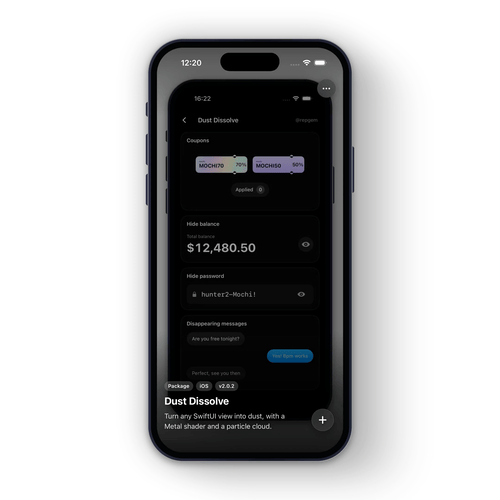

<div align="center">


# Repgem catalog



[**Live demos**](https://repgem.com)

A catalog of polished mobile interactions and drop-in packages, ready to use now, with full source.

[](#-packages)
[](#-packages)
[](LICENSE)
[](CONTRIBUTING.md)

[Feedback](CONTRIBUTING.md) · [Item format](docs/item-format.md) · [X](https://x.com/repgem) · [YouTube](https://www.youtube.com/@RepGem) · [Email](mailto:hello@repgem.com)

</div>

<!-- items:start -->
### 📦 Packages

Drop-in libraries. Click a platform to open that version: what it does, how to install it, and the source.

| Item | What it is | Open |
|:--|:--|:--|
| **Firework Flourish** | Fireworks for any SwiftUI view, continuous or one-shot, with built-in styles and palettes. | [](packages/ios/firework-flourish-ios) |
| **Dust Dissolve** | Turn any SwiftUI view into dust, with a Metal shader and a particle cloud. | [](packages/ios/dust-dissolve-ios) [](packages/android/dust-dissolve-android) |

### ✨ Interactions

Recipes with full source. Click a platform to open it.

| Item | What it is | Open |
|:--|:--|:--|
| **Notification Icon Tray** | Notifications collapse into small icons in a tray as you scroll. | [](interactions/ios/notification-tray) |
| **Notification Group** | Grouped notification card that expands and collapses on tap or drag. | [](interactions/ios/notification-group) |
| **Edge-Swipe Navigation** | Drag from the screen edge to go back or forward, with a peeling screen. | [](interactions/ios/predictive-nav) |
<!-- items:end -->

> **<!-- count -->5<!-- /count --> items** across <!-- versions -->6<!-- /versions --> platform versions so far, and the list grows with every release. ⭐ Star this catalog repo to follow new ones.

## 💡 Why Repgem

Every item is a small, finished piece of interaction design: a demo, the code to build it, and notes on how it works. Take the whole package, or read the source and learn the trick.

- 🎬 **Watch first.** Every item has a demo on [repgem.com](https://repgem.com).
- 🧩 **Real code, not screenshots.** SwiftUI and Jetpack Compose, tested, MIT licensed.
- 🔁 **One idea, every platform.** The same interaction is built for iOS and Android where it makes sense.
- 🧪 **Tested.** Every item carries its own tests, run in CI.
- 💎 **Quality over quantity.** The catalog is small on purpose: only high-quality interactions, each one polished, tested and documented before it is added.

## 🧱 How the repo is laid out

```
packages/<platform>/<slug>/        installable packages
interactions/<platform>/<slug>/    interaction recipes
schema/                            allowed kinds, tags and platforms for item.json
scripts/  tests/                   scaffold, validate and test helpers
```

Every item folder is self-contained: its own `item.json`, `README.md`, source, examples and tests. Packages are also published as their own repositories so they can be installed by URL; this repo stays the source of truth.

## 💬 Feedback and suggestions

For now the catalog is curated by the Repgem team, so it only holds high-quality interactions, and **we are not accepting new items or pull requests yet**. What helps most:

- 🐛 **Found a bug or something rough?** [Open an issue](../../issues) with the item name and your OS or device version.
- 💡 **An interaction you would like to see?** Suggest it in an issue: a screen recording or a link to an app that does it is perfect.
- 💬 **Thoughts on an existing item?** Tell us what felt great or off.
- ✉️ **Prefer email?** Write to [hello@repgem.com](mailto:hello@repgem.com).

Contributions may open later; watch the repo or follow us below to hear first.

<details>
<summary>Working on the catalog (maintainers)</summary>

```bash
bun install
bun run new package ios my-thing "My thing"   # scaffold a folder
bun run test my-thing                         # that item's checks
bun run validate                              # structural check of the whole catalog
bun run readme                                # refresh the list above
```

See [CONTRIBUTING.md](CONTRIBUTING.md) and [docs/item-format.md](docs/item-format.md).

</details>

## 📣 Follow along

New items land here first. Short demos go to [YouTube](https://www.youtube.com/@RepGem), and the thinking behind them to [X](https://x.com/repgem) and [Reddit](https://www.reddit.com/user/repgem/).

## License

[MIT](LICENSE) © ismnoiet. Inspirations are credited in each item's README.
